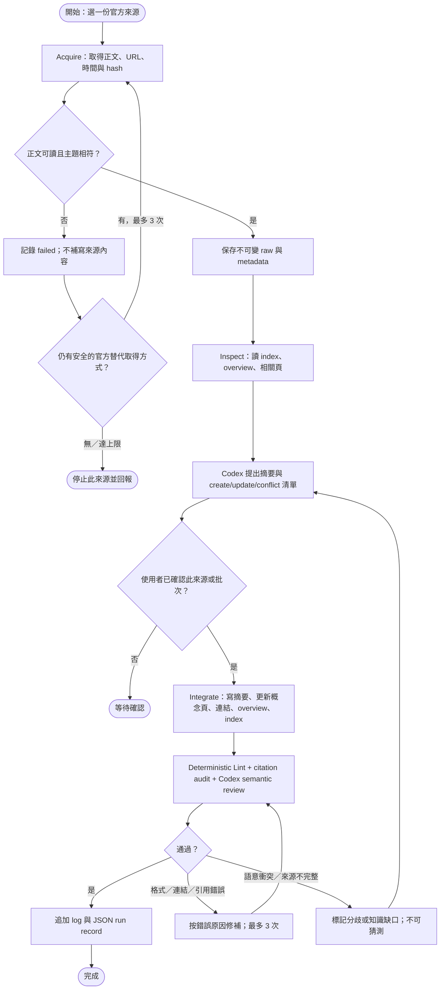
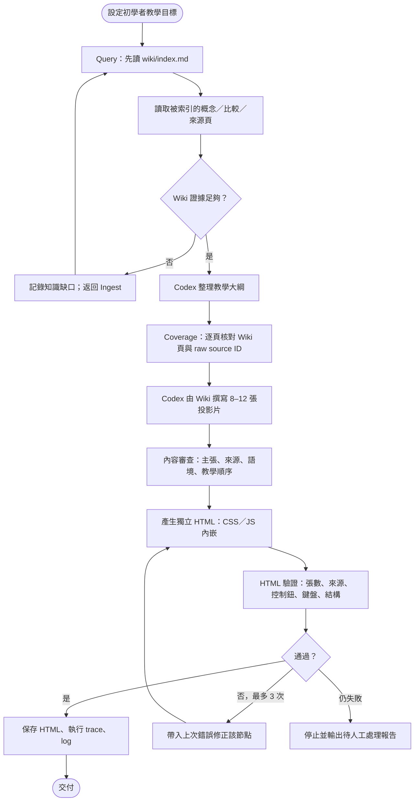

# 可執行流程與重試規則

流程節點由 Codex 維護知識、Python CLI 執行可重現檢查、JSON run record 和 `wiki/log.md` 留存實際執行。每次輸入、輸出、狀態、錯誤、修正和驗證都要能追查。使用者確認節點依當次授權行事；明確批次授權可覆蓋逐篇暫停。

## Graph A：Ingest

### Ingest 失敗分流

- TLS、HTTP 或空正文：記錄為 Acquire failure；最多使用 3 次安全取得嘗試。不得停用 TLS 驗證、繞過存取限制或以模型記憶補原文。
- 正文不完整或只有 JavaScript shell：標記 failed，必要時提出可信的官方替代頁面。
- Broken link、缺 citation 或 metadata：修正並重新 Lint；同一錯誤最多 3 次自動修復。
- 主張衝突：並列來源、語境及段落 ID；無法判定就保留「來源存在分歧／待確認」。

## Graph B：Wiki 到 HTML 簡報

### Retry 規則

- 所有修復都必須記錄上一次錯誤和本次修正，不得無條件重跑同一節點。
- 可自動修復的 Markdown/HTML 問題最多 3 次；第三次仍失敗就停止該分支。
- 需要使用者判斷的來源選擇或無法由資料消解的分歧，不算自動重試；停在待確認狀態並保留依據。
- 真實失敗和注入錯誤的測試必須分開記錄。本專案本次未注入測試錯誤。

## 目前實際運作方式

`app.ingest.cli` 執行 Acquire / Clean / immutable snapshot；Codex 執行 Inspect、Discuss、Integrate 及語意審查；`app.wiki.cli context` 執行 index-first Query；`app.wiki.cli lint` 執行 deterministic checks。Slides 的內容維護由 Codex 按 Query 輸出的 Wiki 上下文完成，HTML 是靜態自包含輸出，不需要 API key。
