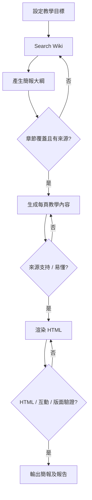

# AGENTS.md — NFC Technology Learning Wiki

> 本文件是 Codex 在此儲存庫中的主要工作規範。所有實作、修改、測試、交付，均須遵守本文件。
> 專案用途：課堂作業「用 LLM Wiki 做一份教學 HTML 簡報」。

## 0. 協作規則（優先級最高）

1. **每次執行前先提出繁體中文計畫，等待使用者確認後才修改檔案或執行具副作用的指令。** 計畫至少包含：本次目標、預計新增/修改的檔案、實作步驟、測試方式、潛在風險。若使用者明確授權一次完成某一範圍，則可在該範圍內連續工作。
2. 對話、README、介面與報告以**繁體中文（台灣用語）**為主；保留 NFC、NDEF、Reader/Writer 等英文技術名稱。
3. 風格務實、簡潔、客觀；禁止宣稱未驗證的功能已完成。
4. 完成後列出：新增/修改的檔案、各檔用途、執行指令、測試結果、尚未完成事項。
5. 優先實作可執行的最小版本；不得未經同意加入登入系統、雲端資料庫、複雜 Agent 框架或與作業無關的功能。
6. 使用 Git 進行小步提交；不得刪除使用者資料或覆蓋既有輸出而不先備份/確認。

## 1. 專案目標與驗收成果

專案名稱：**NFC 近場通訊技術入門（NFC Technology Learning Wiki）**。

使用真實、可追溯的官方資料建立 LLM Wiki，再透過查詢 Wiki、整理、驗證與重試的 Workflow / Graph，製作可讓初學者理解 NFC 的 HTML 教學簡報。

必須交付：

- 可在瀏覽器閱讀的 Wiki：有章節目錄、文章頁、關聯文章及可點擊來源。
- **至少 5 份不同且有實質內容的來源文件成功 Ingest**，有原文、Metadata、狀態及紀錄；僅輸入 URL 或只建立來源清單不算 Ingest。
- AI 根據來源生成/修訂的 Wiki 文章，重要技術主張能追溯至原文。
- Wiki 搜尋（初版可用 SQLite FTS5 或本地全文搜尋，不強制向量資料庫）。
- 可觀察的 Wiki Ingest Loop 及簡報生成 Graph：有節點、判定、分支、重試上限、日誌。
- 根據 Wiki **實際檢索結果**生成的教學 HTML 簡報（約 8–12 頁），含可點擊來源與鍵盤/按鈕翻頁。
- 一次**真正執行**的結果、驗證及錯誤紀錄；最後反思只能根據實際發生的問題撰寫，不可虛構。
- README：安裝、設定、啟動、Ingest、Wiki 生成、簡報生成、驗證、截圖與作業說明。

### 不做的功能

不需要會員登入、付費服務、排程爬蟲、多租戶、複雜分散式部署、強制使用 RAG/向量資料庫。不能把「固定寫死的 Wiki 文章或簡報」假裝成 LLM 執行成果。

## 2. 讀者與內容架構

目標：沒有 NFC 背景的一般初學者。文章先解釋日常例子，再介紹原理，術語第一次出現時需有簡短定義。

Wiki 六章：

1. **NFC 基礎概念**：定義、特色、應用情境。
2. **NFC 運作原理**：13.56 MHz、近場耦合、被動/主動裝置、範圍與限制。
3. **NFC 運作模式**：Reader/Writer、Card Emulation、Peer-to-Peer（須註明標準與平台實作差異；不要誤稱所有現代手機都支援所有模式）。
4. **NFC 標籤與資料**：Tag、NDEF、Message、Record 與基本讀寫概念。
5. **NFC 實際應用**：支付、交通、門禁、智慧設備；區分底層 NFC 與上層業務/安全協定。
6. **NFC 安全與限制**：惡意標籤、讀取風險、權限、平台限制及合理防護；不可聲稱「距離短即絕對安全」。

推薦導覽：首頁 → 六章目錄 → 各文章 → 相關文章 → 來源列表 → 簡報 → 執行紀錄。

## 3. 來源清單（先核實可用性）

優先使用官方、可公開讀取的技術內容。以下為候選來源，**實作時必須確認 HTTP 可存取、正文完整且相關，才算有效來源**。網頁可能搬遷或改版；可替換為同一官方機構的更適合頁面，並記錄原 URL、新 URL 與替換原因。

| ID | 機構/文件 | URL | 主要用途 |
| --- | --- | --- | --- |
| S01 | NFC Forum — NFC Technology | https://nfc-forum.org/learn/nfc-technology/ | 定義、基礎、技術原理 |
| S02 | NFC Forum — Specifications | https://nfc-forum.org/build/specifications/ | 規格索引、術語驗證 |
| S03 | STMicroelectronics — NFC technology resources | https://www.st.com/content/st_com/en/support/learning/essentials-and-insights/connectivity/nfc.html | NFC 硬體與應用 |
| S04 | Android Developers — NFC basics | https://developer.android.com/develop/connectivity/nfc/nfc | Tag、NDEF、讀寫 |
| S05 | EMVCo — EMV Contactless Chip | https://www.emvco.com/emv-technologies/emv-contactless-chip/ | 非接觸式支付與 NFC 區別 |
| S06 | Android Developers — Host-based Card Emulation | https://developer.android.com/develop/connectivity/nfc/hce | 卡片模擬 |
| S07 | Apple Developer — Core NFC | https://developer.apple.com/documentation/corenfc/ | Apple 平台實作 |
| S08 | NFC Forum — What NFC Does | https://nfc-forum.org/learn/what-nfc-does/ | 日常應用 |

**特別注意：** S02 是規格索引，不可把索引頁當成已讀取的整份規格；如欲使用技術規格，須抓取實際可取得的規格正文。S03 若無法存取，換成 ST 同主題、可公開閱讀的官方資料。S07 若正文需要 JavaScript 渲染，採合法可讀版本或更換合適的官方說明。付費、禁止抓取或無法取得內容的資料不得偽造或假設已讀取。

來源清單必須記錄：source_id、title、organization、original_url、resolved_url、content_type、fetched_at、http_status、sha256、ingest_status、notes、rights_or_access_note。

## 4. 建議技術與專案結構

原則：本機可執行、易於展示、減少依賴。

- 後端：**Python 3.11+ / FastAPI**；環境變數管理金鑰；HTTP 擷取用 httpx，正文萃取可用 BeautifulSoup / trafilatura（需依網站結構決定）。
- Wiki 儲存：Markdown 檔 + JSON Metadata；搜尋初版採 SQLite FTS5（若建置環境不支援，使用可測試的全文搜尋 fallback）。
- LLM：明確的 provider adapter，支援一個**實際可呼叫**的模型供應方式；金鑰、base URL、model 由環境變數指定。不要在程式、Git、日誌存放金鑰。
- 前端：HTML/CSS/少量 JavaScript，偏淺色、乾淨、資訊導向、桌機優先並支援手機。
- 簡報：生成**自包含的 HTML**（必要 CSS/JS 可內嵌），能離線打開；技術敘述來自 Wiki 檢索內容，而非直接由 LLM 常識補完。
- Graph：先用**明確 Python 節點及狀態轉移**實作，不必為了名稱引入 LangGraph 等框架；若使用框架，需在 README 說明理由。

建議資料夾（可合理調整，但須在 README 記載）：

```text
nfc-learning-wiki/
├── AGENTS.md
├── README.md
├── .env.example
├── .gitignore
├── pyproject.toml                  # 或 requirements.txt
├── app/
│   ├── main.py                     # FastAPI app / API
│   ├── ingest/                     # fetch, clean, extract, validate
│   ├── wiki/                       # 文章產生、引用、搜尋、索引
│   ├── slides/                     # 簡報大綱、內容、HTML 渲染及驗證
│   ├── graph/                      # 節點、狀態、重試、流程記錄
│   └── llm/                        # LLM provider adapter / prompts
├── web/                            # Wiki UI 靜態資產/模板
├── data/
│   ├── sources.json                # 來源清單與狀態
│   ├── raw/                        # 擷取原文（保留來源）
│   ├── cleaned/                    # 清理後文件
│   ├── wiki/                       # Markdown 文章
│   ├── index/                      # 搜尋索引（可重建）
│   └── runs/                       # 每次執行的事件/結果紀錄
├── output/
│   └── slides/                     # 產生之教學 HTML 簡報
├── tests/
└── docs/
    ├── workflow.md                # Mermaid + 失敗分支說明
    ├── sources.md                 # 來源與授權/存取說明
    ├── execution-report.md        # 真實執行紀錄與反思
    └── submission.md              # 五項作業繳交內容
```

不要將 `.env`、API Key、私人資料上傳 Git；大型原文若有再散布限制，僅本地保存，公開 repo 提供引用 URL、Metadata 及合法撰寫的轉述內容。遵守網站 robots/使用條款、合理速率及著作權，不要繞過付費牆/存取限制。

## 5. Ingest Pipeline（必須真實可執行）

### A1. Fetch

- 對來源 URL 發 HTTP 請求，設置 timeout、User-Agent 與低頻重試；檢查 HTTP 狀態與 content-type。
- 只接受可讀內容；遇到 JS 動態頁面，可用合法手動匯入/官方替代來源。
- 保存原文或可供驗證的文字擷取結果，計算 hash；重複 hash 不計作獨立成功來源。
- 記錄失敗原因，禁止從 LLM 補造原始文件。

### A2. Clean

- 移除選單、腳註雜訊、Cookie 提示、重複頁尾；保留段落標題、表格、關鍵上下文。
- 輸出清理文字與能定位原始文段的 section/paragraph 識別碼。
- 檢查文字長度、語言與主題相關性，避免把空頁/導覽頁算作 ingest 成功。

### A3. Extract / Draft（LLM）

- 根據清理後文字生成結構化知識：概念、初學者說明、術語、相關章節、來源定位。
- **每個重要事實主張附 source_id 與可回查的原文段落定位**。無法定位的主張標記 unsupported，不可直接發布。
- AI 將資料整合為繁體中文 Wiki 文章；不是逐句全文翻譯，也不能憑空補充數值或標準定義。

### A4. Validate

程式規則：schema 完整、來源存在、source_id 有效、引用定位可回查、最低文字品質、去重、章節歸類、必要術語覆蓋。

LLM 審查：由原始來源段落核對該主張是否被支持、是否曲解、是否適合初學者。LLM 評分只是輔助；對標準規範有疑義時需人工檢查，不可視為客觀事實驗證。

驗證回傳機器可讀報告，包括 `status`、`issues[]`（type、severity、claim、source_id、suggested_action）。

### A5. Publish

- 只有 `passed` 的文章可發布為正式 Wiki；其他標為 draft/needs_review。
- 維持 Markdown front matter 或 JSON Metadata：article_id、title、chapter、summary、source_ids、references、related_articles、updated_at、validation_status、run_id。
- 發布時重建搜尋索引；使用者點引用可返回來源 URL/段落資訊。

## 6. Workflow / Graph：狀態、分支與停止條件

**流程 A：來源 → Wiki**

```mermaid
flowchart TD
  A[Fetch] --> B{來源可讀?}
  B -- 否 --> BF[記錄錯誤 / 重試或替換來源]
  BF -->|重試次數未滿| A
  B -- 是 --> C[Clean]
  C --> D{正文完整?}
  D -- 否 --> BF
  D -- 是 --> E[Extract / Draft]
  E --> F[Validate Claims & Sources]
  F --> G{通過?}
  G -- 否：內容問題 -->|帶具體意見| E
  G -- 否：原文缺漏 --> C
  G -- 是 --> H[Publish Wiki]
```

**流程 B：Wiki → HTML 簡報**



所有 Loop 都須：

1. 設定**單節點最多 3 次嘗試**，超過後停止並標記人工處理，不能無限循環。
2. 每次重試附上先前的具體錯誤，不可原樣重抽、無差別全部重生成。
3. 把「網路故障」「來源不足」「事實未獲支持」「排版錯誤」導回不同節點；不要所有失敗都叫 LLM 重寫。
4. 每個 Graph run 有 `run_id`、狀態、開始/結束時間、節點事件、重試計數、最後結果。
5. 無足夠的已驗證 Wiki 知識時，**中止簡報生成並明示缺少的內容**，不得自動使用模型既有知識補齊。
6. 區分 LLM 輸出內容、規則驗證與人工覆核，不可把 LLM 自評當作唯一驗證。

## 7. HTML 簡報規格

- 面向初學者，約 **8–12 頁**；建議：封面、NFC 是什麼、運作原理、三種模式、Tag/NDEF、生活應用、支付案例、安全風險、比較/常見誤解、重點回顧、來源。
- 每頁原則上只講一個核心概念，避免大段落，能以簡單圖示/流程圖輔助。
- 功能：上一頁/下一頁、左右方向鍵、頁碼/進度、直接開啟 HTML；可選全螢幕，不需要網路即可閱讀。
- 保證 UTF-8、繁體中文、對比與字體可讀、適合 16:9 投影、畫面不溢出；提供縮放/窄螢幕基本適應。
- 每頁內容須有對應 Wiki article ID 與來源 ID；末頁呈現正式參考來源連結。
- **禁止在無 Wiki 檢索結果的情況下直接生成完整簡報**。簡報需保存本次使用的文章清單及產生時的引用記錄。
- HTML 不允許直接執行或插入來自抓取網頁的不受信任 script/HTML；使用安全文字渲染、必要的 HTML escaping。

## 8. 執行紀錄、量化檢查與反思

對每次流程執行，記錄 JSONL 或 JSON（可另提供人類可讀摘要）：

- `run_id`, `workflow`, `node`, `started_at`, `ended_at`, `attempt`, `status`, `input_refs`, `output_refs`, `issues`, `decision`, `next_node`。
- 不儲存 API 金鑰/敏感憑證；可儲存提示詞版本、模型名稱、來源 hash、錯誤類型及耗時。
- 報告至少有：來源總數/成功 ingest 數、Wiki 文章數、成功/失敗節點次數、每節點重試數、簡報頁數、驗證結果。

`docs/execution-report.md` 必須由**實際執行結果**撰寫，回答：

1. 最常出錯的是哪個節點？用次數與具體事件支持。
2. 發現問題後把檢查提前到哪個步驟？若沒有修改，坦白註明並提出建議。
3. 是否因此更改 Workflow / Graph？更改前後、原因及效果。

若一次執行沒有出錯，不可虛構失敗；可主動進行有註記的受控失敗測試（如無效 URL、缺少引用、故意超長投影片），與正式執行數據分開列示。

## 9. API / 操作介面最低需求

Codex 可依情況選擇 CLI、API 或網頁按鈕操作，但**每項作業功能都必須可被實際觸發與觀察**：

- 來源清單、單篇/批次 Ingest、Ingest 結果。
- 產生/修訂 Wiki、章節瀏覽、搜尋與原文引用。
- 從 Wiki 產生簡報、檢視/下載 HTML。
- 檢視最近 Run 的節點事件、失敗原因及重試結果。

若採 FastAPI，可自行設計 `/api/sources`、`/api/ingest`、`/api/wiki`、`/api/search`、`/api/slides/generate`、`/api/runs` 等清楚一致的路由。處理較久的操作需提供可追蹤的執行狀態；不要回傳虛假的即時完成結果。

## 10. 測試與驗收

必要自動化測試：

- Fetch：成功頁、404、逾時、非 HTML、空白正文。
- Clean：導覽噪音移除、關鍵段落保留。
- Metadata：必填欄位、URL/hash/去重與日期。
- Citation：不存在的 source ID、缺少段落定位或 unsupported claim 被拒絕。
- Graph：正常成功、重試後成功、超過 3 次停止、不同失敗分流正確。
- Search：Wiki 搜尋能回傳文章 ID、摘要與來源。
- Slides：無已驗證文章時不得生成、HTML 可打開、頁碼/操作鍵有效、引用不遺失。
- 安全：HTML 注入防護、祕密不外洩、外部文件不能透過 prompt injection 改寫系統規則。

驗收清單：

- [ ] 至少 5 份**不同有效正文**成功 ingest，能展示 URL、原文與 Metadata。
- [ ] 六個知識章節能瀏覽，重要主張有引用。
- [ ] 使用者能查詢 Wiki，能辨識引用來源。
- [ ] Wiki 與簡報 Workflow 可看到真實 Loop 分支與重試紀錄。
- [ ] HTML 簡報 8–12 頁，能瀏覽、能離線開啟，適合入門教學。
- [ ] `docs/execution-report.md` 有真實執行紀錄與反思。
- [ ] `docs/submission.md` 包含老師要求的五項作業內容。
- [ ] README 有在乾淨環境重現的完整操作步驟。

## 11. 建置順序（先做能驗證的垂直切片）

**階段 1 — 骨架與來源：** 建立專案與 README、source registry、Fetch/Clean、取得至少 5 份成功資料。此階段不假設 LLM 已可用。

**階段 2 — Wiki 與來源驗證：** LLM adapter、Extract/Draft、Validate/Publish、Markdown 文章與搜尋。先完成一篇端到端，再擴至六章。

**階段 3 — Graph 與可視化紀錄：** 將節點與條件分支串起來，加入重試限制、執行日誌及可查看結果的 UI。

**階段 4 — 簡報：** 由 Wiki 搜尋組成大綱，生成內容、驗證引用，輸出自包含 HTML；檢查操作與版面。

**階段 5 — 實測與繳交：** 完成正式執行、收集真實數據與截圖、製作 `execution-report.md` 和 `submission.md`，根據失敗結果調整 Graph。

每階段先提出計畫取得確認，再實作、測試並回報結果。不可跳過資料來源驗證，直接生成靜態展示頁宣稱已完成專案。

## 12. 繳交內容模板

`docs/submission.md` 必須依序包含：

1. **LLM Wiki 主題與簡短介紹**：NFC 是什麼、為何選它、目標讀者及 Wiki 涵蓋範圍。
2. **LLM Wiki 連結或成果**：實際部署連結（若有）、本機執行方式、Wiki 和 HTML 簡報截圖/檔案路徑。
3. **Loop / Graph 流程圖或文字說明**：兩條流程、重試條件、停止條件、為什麼這樣設計。
4. **一次實際執行的結果或檢查紀錄**：Run ID、Ingest 數量、Wiki 篇數、簡報頁數、節點事件與實際結果。
5. **反思**：最常出錯節點、將檢查提前到何處、是否修改 Graph、調整理由及效果。

---

**給 Codex 的第一個行動：** 先讀本文件，使用繁體中文提出「階段 1：專案骨架與官方資料 Ingest」的具體計畫，列出檔案、操作步驟、驗收測試、可能的網站擷取限制；**等待使用者確認，不要直接修改檔案。**
